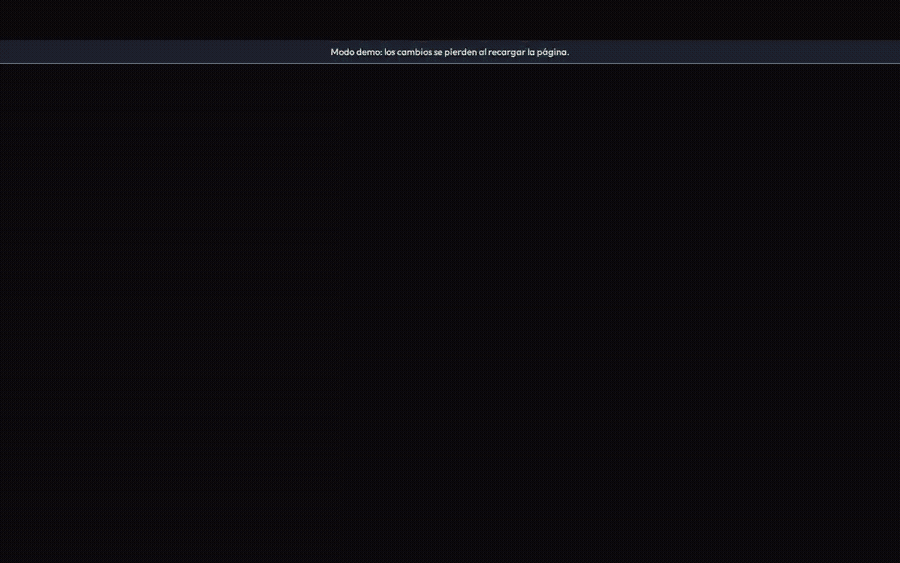
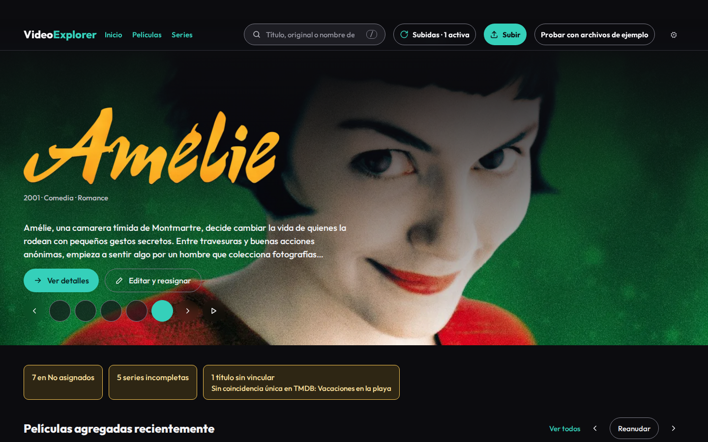
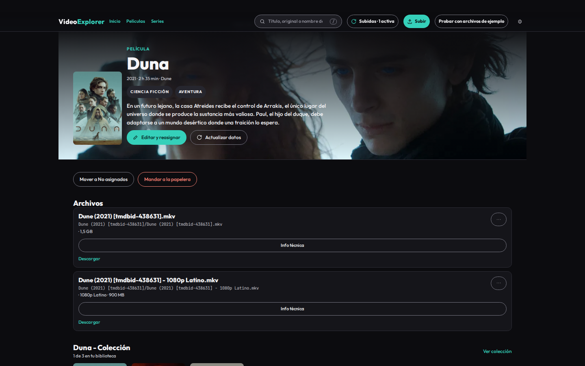
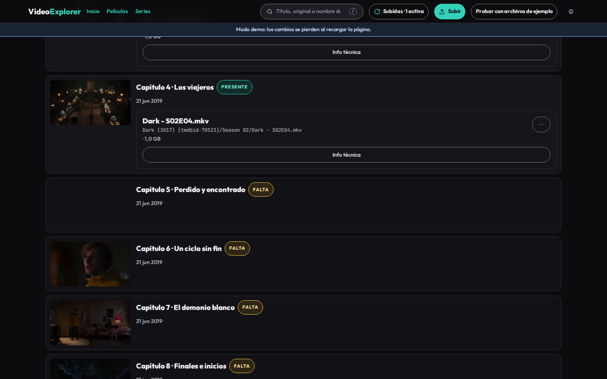
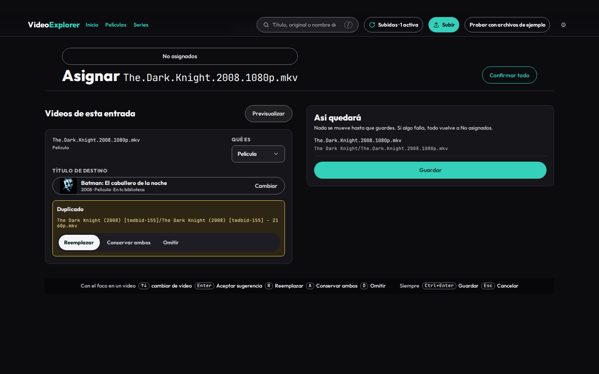
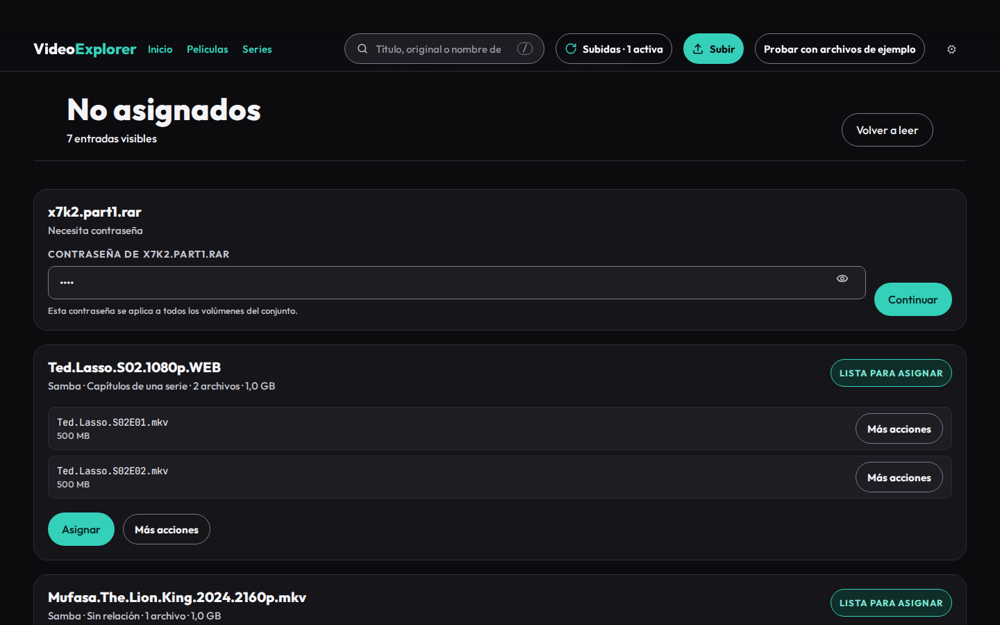
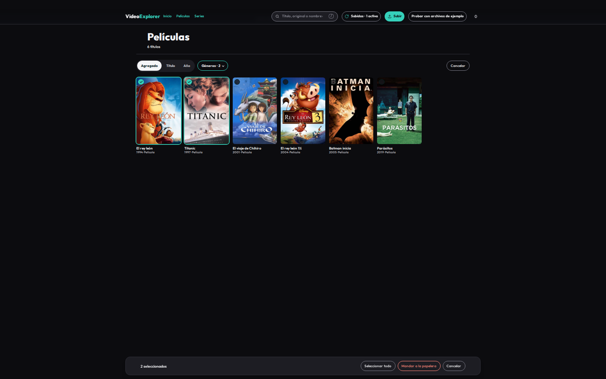
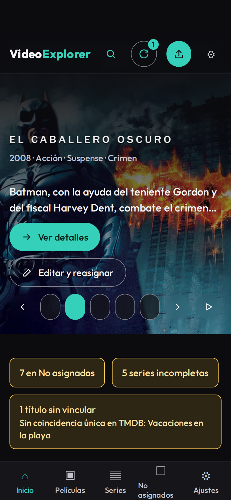

# VideoExplorer

[English](README.md) · **Estado: terminado — última versión v1.0.2**

[](https://github.com/CarlosSV923/VideoExplorer/actions/workflows/ci.yml)



VideoExplorer es una app web autoalojada para un NAS doméstico (TrueNAS SCALE). Organiza películas y series para que Jellyfin las reconozca, con una interfaz de biblioteca estilo Netflix. Gestiona archivos; nunca reproduce video.

## Qué hace hoy

- Explora una biblioteca estilo Netflix de películas, series, temporadas, capítulos y colecciones.
- Sube uno o varios archivos con subidas reanudables mediante [tus](https://tus.io/), incluidos comprimidos zip, 7z y rar.
- Descomprime con 7-Zip, filtra videos y subtítulos externos, y manda lo descartado a la papelera en vez de borrarlo.
- Lleva los archivos subidos o copiados por SMB a **No asignados** y **Asignar**, con sugerencias de títulos de TMDB (por nombre, id de TMDB, id de IMDb o un enlace pegado) o un nombre libre. Lo copiado por SMB se detecta solo.
- Nombra carpetas, videos y subtítulos con la convención de Jellyfin, incluida la etiqueta opcional `[tmdbid-ID]`, decisiones de duplicados, versiones, partes y numeración de capítulos.
- Edita y reasigna archivos de la biblioteca, descarga archivos o títulos, selecciona varios títulos para mandarlos a la papelera de una vez, restaura elementos de la papelera y la vacía de forma permanente.
- Ofrece ajustes de idioma, escaneos, TMDB y Jellyfin, y, si Jellyfin está configurado, le pide refrescar solo las carpetas afectadas tras cada cambio en la biblioteca.
- Funciona en español e inglés con ratón, teclado, táctil y gamepad.

Los requisitos detallados y el trabajo actual están en [`docs/spec.md`](docs/spec.md) y [`docs/tasks.md`](docs/tasks.md). El sistema de diseño y el comportamiento adaptable están en [`docs/design-handoff.md`](docs/design-handoff.md). Los vectores de nombres y clasificación están en [`contracts/`](contracts/README.md).

## Demo en línea

**Demo:** [video-explorer-sepia.vercel.app](https://video-explorer-sepia.vercel.app). Funciona sin backend; los cambios en memoria se pierden al recargar. Las imágenes de TMDB se cargan desde `image.tmdb.org`.

**Arquitectura interactiva:** [carlossv923.github.io/VideoExplorer/es/](https://carlossv923.github.io/VideoExplorer/es/) — explora la arquitectura del sistema y el ciclo de vida de una subida.

## Capturas

| | |
|---|---|
|  |  |
|  |  |
|  |  |

<p align="center"></p>

Las capturas y el GIF se generan desde la demo con `task screenshots`. Los pósters y fondos vienen de TMDB.

## Imagen de producción

La imagen para TrueNAS es `ghcr.io/carlossv923/videoexplorer`. Al crear un tag de versión `v*`, se publican el tag semver correspondiente y `latest` para `linux/amd64`; los pull requests solo construyen la imagen. Para construirla localmente, ejecuta `task image`.

La imagen incluye `ffprobe` de jellyfin-ffmpeg 8.1.3-1, bajo GPL-3.0. Su licencia y aviso están en `/usr/share/doc/videoexplorer/ffprobe/` dentro de la imagen. El [código fuente de la versión fijada](https://github.com/jellyfin/jellyfin-ffmpeg/tree/v8.1.3-1) está disponible en Jellyfin-FFmpeg. `ffprobe` se ejecuta como proceso independiente; VideoExplorer conserva su licencia MIT.

## Estado del proyecto

Todas las fases (0–12) están cerradas y publicadas como **v1.0.0**: la API, la interfaz web completa (biblioteca, subidas, No asignados, Asignar, edición, papelera con selección múltiple, ajustes), la demo sin backend en Vercel con pruebas de punta a punta y la imagen de producción en GHCR, probada en un NAS TrueNAS SCALE real con contenido real y Jellyfin. El historial de tareas está en [`docs/tasks.md`](docs/tasks.md).

## Instalar en TrueNAS SCALE

Crea un dataset multimedia para `/library` y otro para el estado de la app en `/data`. Mantén `Movies/`, `TV Shows/`, `_unassigned/` y `.videoexplorer/` (staging y papelera) en el dataset multimedia. Da una ACL heredada **Modify** al UID:GID de `user:` en el compose para ambos datasets. Genera `APP_PASSWORD_HASH` con `task hash-password` y configura un `SESSION_SECRET` aleatorio de al menos 32 bytes. Luego instala [`deploy/truenas/compose.yaml`](deploy/truenas/compose.yaml) desde **Apps → Discover Apps → Custom App → Install via YAML**. Tras el primer arranque, comprueba `http://<ip-del-nas>:8080/api/health`. La guía del compose explica la configuración de Jellyfin, la detección de rutas y las actualizaciones: [`deploy/truenas/README.md`](deploy/truenas/README.md).

El escaneo de respaldo de la biblioteca se ejecuta cada 6 horas y el de `_unassigned/` cada 30 minutos. El compose de TrueNAS configura estos intervalos con `LIBRARY_SCAN_INTERVAL` y `UNASSIGNED_SCAN_INTERVAL`; lo que se copia al NAS (por ejemplo por SMB) también se detecta solo mediante los avisos del sistema de archivos.

La detección automática requiere que las copias lleguen al mismo NAS, por Samba/SMB o localmente en el NAS. Si no se detecta un cambio, «Escanear ahora» sigue disponible en Ajustes.

## Desarrollo

Requisitos: Docker, Node.js 24 o posterior, pnpm 12.9.1 y Task 3.

Instala las dependencias y levanta los servicios:

```bash
task install
task dev:api       # API de Go en Docker, http://localhost:8080
task dev:web       # frontend de Vite, http://localhost:5173
```

El servicio de desarrollo de la API está definido en [`compose.dev.yaml`](compose.dev.yaml). Usa `./.dev/library` y `./.dev/data` como datos locales de desarrollo y pasa la configuración local opcional de `.env.local`. No subas secretos al repositorio.

Comprobaciones útiles:

```bash
task check         # OpenAPI, lint/tests de Go y web, vulnerabilidades y builds
task gen           # Regenera el código de OpenAPI y SQL
task build:web     # Construye el frontend
task build:demo    # Construye con los adaptadores de demo
task e2e           # Ejecuta Playwright en Docker (escritorio y móvil táctil)
task screenshots   # Capturas y GIF del README desde la demo
```

Consulta [`Taskfile.yml`](Taskfile.yml) para ver todas las tareas. Las herramientas de Go corren en Docker para coincidir con la CI y con las rutas Linux de producción.

## Arquitectura

**Diagramas interactivos:** [carlossv923.github.io/VideoExplorer/es/](https://carlossv923.github.io/VideoExplorer/es/) — versiones explorables de los dos diagramas de abajo (arquitectura del sistema y ciclo de vida de una subida), generadas con [Archify](https://github.com/tt-a1i/archify) desde [`docs/architecture/`](docs/architecture/).

<p align="center"><a href="https://carlossv923.github.io/VideoExplorer/es/architecture.html"></a></p>

Una subida es un trabajo que sigue esta máquina de estados (spec RF-10a); su resultado llega a **No asignados**, y nada entra en la biblioteca sin que el usuario lo confirme en **Asignar**:

<p align="center"><a href="https://carlossv923.github.io/VideoExplorer/es/upload-lifecycle.html"></a></p>

Haz clic en un diagrama para abrir su versión interactiva.

| | |
|---|---|
| Backend | Go, `net/http`, tusd, SQLite (modernc + sqlc + goose), fsnotify, 7-Zip y ffprobe como procesos hijos |
| Frontend | React 19, Vite, TypeScript, Tailwind CSS 4, TanStack Router/Query, tus-js-client, i18next |
| Contrato | OpenAPI 3, spec-first: el servidor Go y el cliente TS se generan |
| Diseño | Domain-Driven Design en ambos lados (catalog, ingestion, metadata, mediaservers, identity), puertos y adaptadores; Go y TypeScript comparten vectores dorados de nombres y lectura de nombres de archivo |
| Calidad | Tests de Go y Vitest, E2E con Playwright en escritorio y móvil táctil, golangci-lint, ESLint estricto, govulncheck en la CI |

El backend y el frontend usan Domain-Driven Design, con paquetes de dominio puros y puertos/adaptadores. Las áreas principales son:

| Área | Responsabilidad |
|---|---|
| `apps/api` | API de Go, SQLite, operaciones, extracción y organización de archivos |
| `apps/web` | React, Vite, TypeScript, i18n e interfaz adaptable |
| `api` | Fuente de verdad de OpenAPI |
| `contracts` | Vectores dorados compartidos |
| `docs` | Requisitos, estado de tareas y handoff de diseño |

Los archivos se transmiten y los datos de video no se almacenan completos en memoria. Las rutas se construyen en el servidor a partir de IDs y los secretos de TMDB y Jellyfin nunca llegan al navegador. Plex queda fuera de esta versión.

## Legal

VideoExplorer no incluye, descarga ni distribuye películas o series. Úsalo solo con archivos que tengas derecho a conservar. TMDB se usa para metadatos; VideoExplorer no está avalado ni certificado por TMDB.

Licencia [MIT](LICENSE).
