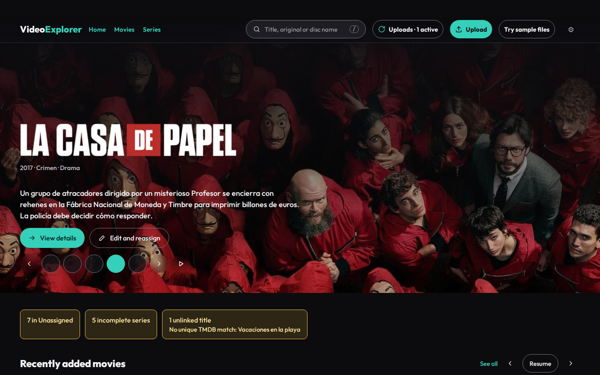
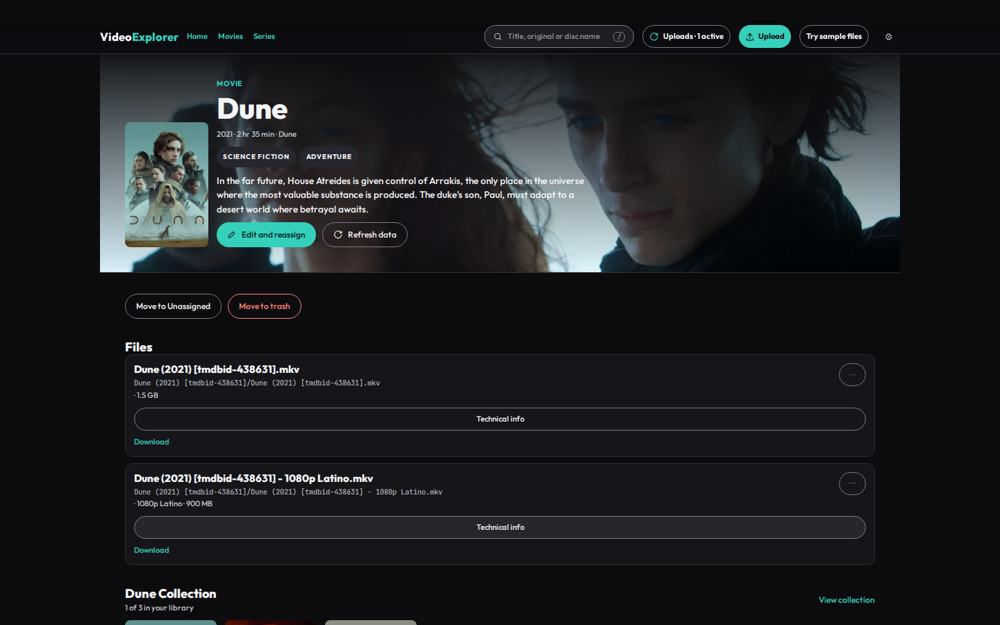
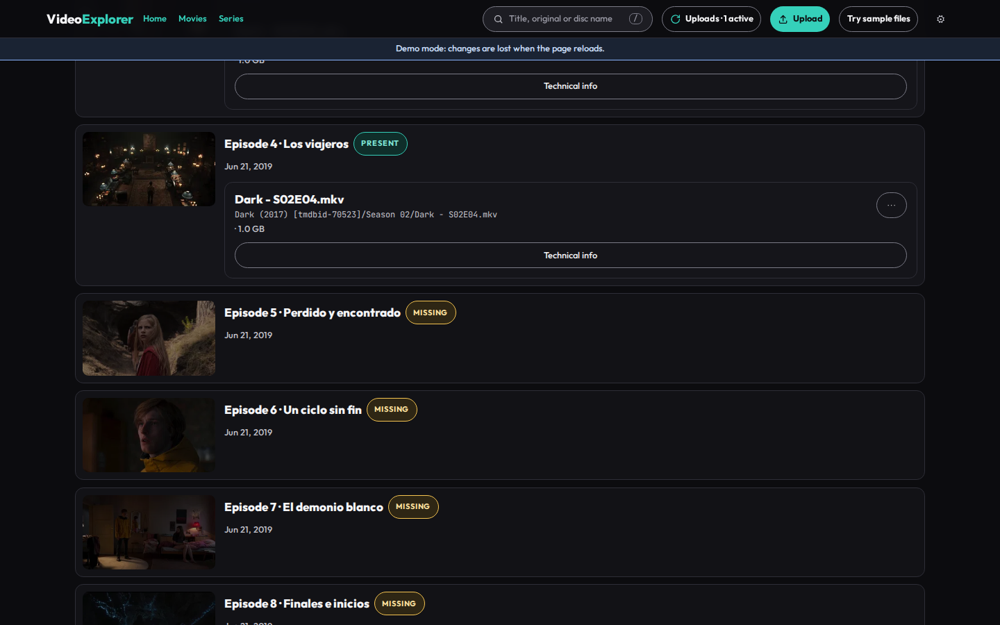
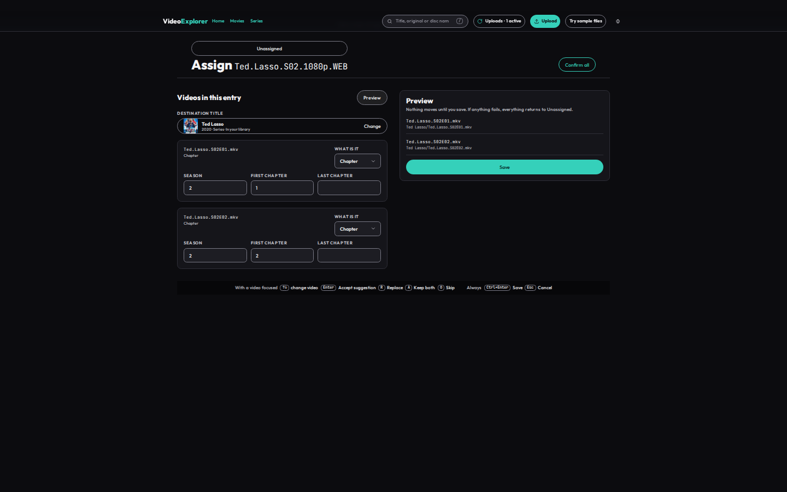
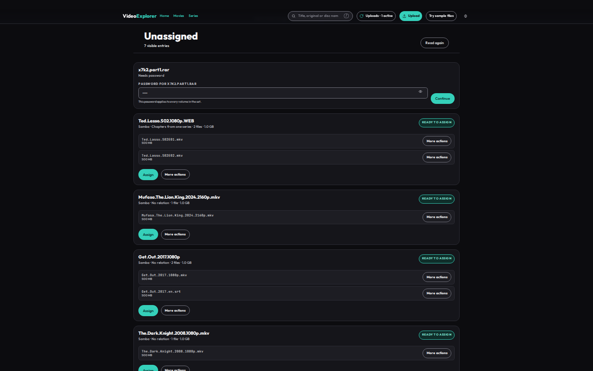
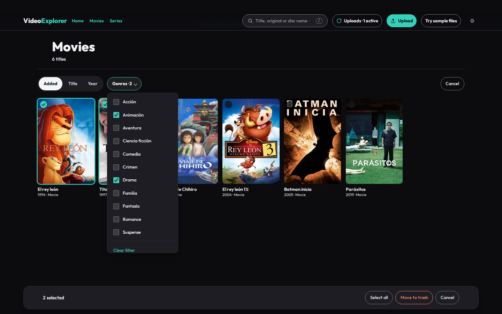
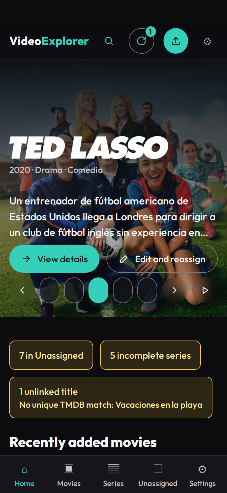

# VideoExplorer

[Español](README.es.md) · **Status: complete — latest release v1.0.2**

[](https://github.com/CarlosSV923/VideoExplorer/actions/workflows/ci.yml)


VideoExplorer is a self-hosted web app for a home NAS (TrueNAS SCALE). It organizes movies and TV series so Jellyfin recognizes them, with a Netflix-style library UI. It manages files; it never plays video.

## What it does today

- Browses a Netflix-style library of movies, series, seasons, episodes and collections.
- Uploads one or more files with resumable [tus](https://tus.io/) uploads, including zip, 7z and rar archives.
- Extracts archives with 7-Zip, filters videos and external subtitles, and sends discarded content to the trash instead of deleting it.
- Moves uploaded or SMB-copied files through **Unassigned** and **Assign**, with title suggestions from TMDB (by name, TMDB ID, IMDb ID or a pasted link) or a free title. Files copied over SMB are detected automatically.
- Names folders, videos and subtitles using the Jellyfin convention, including optional `[tmdbid-ID]` tags, duplicate decisions, versions, parts and episode numbering.
- Edits and reassigns library files, downloads files or titles, selects several titles to move them to the trash at once, restores items from the trash, and permanently purges trash entries.
- Provides settings for language, scans, TMDB and Jellyfin, and, when Jellyfin is configured, asks it to refresh only the affected folders after each library change.
- Supports Spanish and English with mouse, keyboard, touch and gamepad input.

The detailed requirements and current work are in [`docs/spec.md`](docs/spec.md) and [`docs/tasks.md`](docs/tasks.md). The design system and responsive behavior are in [`docs/design-handoff.md`](docs/design-handoff.md). The naming and classification vectors live in [`contracts/`](contracts/README.md).

## Online demo

**Live demo:** [video-explorer-sepia.vercel.app](https://video-explorer-sepia.vercel.app). The demo runs without a backend; its in-memory changes reset when the page reloads. TMDB images load from `image.tmdb.org`.

**Interactive architecture:** [carlossv923.github.io/VideoExplorer](https://carlossv923.github.io/VideoExplorer/) — explore the system architecture and the upload job lifecycle.

## Screenshots

| | |
|---|---|
|  |  |
|  |  |
|  |  |

<p align="center"></p>

Screenshots and GIF are generated from the demo with `task screenshots`. Posters and backdrops come from TMDB.

## Production image

The TrueNAS production image is `ghcr.io/carlossv923/videoexplorer`. A `v*` release tag publishes the matching semver tag and `latest` for `linux/amd64`; pull requests build the image without publishing it. Build it locally with `task image`.

The image includes `ffprobe` from jellyfin-ffmpeg 8.1.3-1, licensed under GPL-3.0. Its license and notice are at `/usr/share/doc/videoexplorer/ffprobe/` in the image. The corresponding [pinned source code](https://github.com/jellyfin/jellyfin-ffmpeg/tree/v8.1.3-1) is available from Jellyfin-FFmpeg. `ffprobe` runs as a separate process; VideoExplorer remains MIT-licensed.

## Project status

All phases (0–12) are complete and released as **v1.0.0**: the API, the full web UI (library, uploads, Unassigned, Assign, edit, multi-select trash, settings), the backend-less demo on Vercel with end-to-end tests, and the production image on GHCR, tested on a real TrueNAS SCALE NAS with real content and Jellyfin. The task history is in [`docs/tasks.md`](docs/tasks.md).

## Install on TrueNAS SCALE

Create a media dataset for `/library` and a separate app-state dataset for `/data`. Keep `Movies/`, `TV Shows/`, `_unassigned/`, and `.videoexplorer/` (staging and trash) on the media dataset. Set an inherited **Modify** ACL for the compose `user:` UID:GID on both datasets. Generate `APP_PASSWORD_HASH` with `task hash-password`, set a random `SESSION_SECRET` of at least 32 bytes, then install [`deploy/truenas/compose.yaml`](deploy/truenas/compose.yaml) as **Apps → Discover Apps → Custom App → Install via YAML**. After first start, check `http://<nas-ip>:8080/api/health`. The compose guide covers Jellyfin setup, path detection and version updates: [`deploy/truenas/README.md`](deploy/truenas/README.md).

The fallback library scan runs every 6 hours, and the `_unassigned/` scan every 30 minutes. The TrueNAS compose sets these as `LIBRARY_SCAN_INTERVAL` and `UNASSIGNED_SCAN_INTERVAL`; files copied to the NAS (for example over SMB) are also detected automatically through filesystem notifications.

Automatic detection requires copies to reach the same NAS, through Samba/SMB or locally on the NAS. If a change is not detected, **Scan now** remains available in Settings.

## Development

Requirements: Docker, Node.js 24 or later, pnpm 12.9.1, and Task 3.

Install dependencies and start the services:

```bash
task install
task dev:api       # Go API in Docker at http://localhost:8080
task dev:web       # Vite frontend at http://localhost:5173
```

The API development service is defined in [`compose.dev.yaml`](compose.dev.yaml). It uses `./.dev/library` and `./.dev/data` as local development data and passes optional local configuration from `.env.local`. Do not commit secrets.

Useful checks:

```bash
task check         # OpenAPI, Go, web lint/tests, vulnerability scan and builds
task gen           # Regenerate OpenAPI and SQL code
task build:web     # Build the frontend
task build:demo    # Build with the demo adapters
task e2e           # Run Playwright E2E in Docker (desktop and touch mobile)
task screenshots   # README screenshots and GIF from the demo
```

See [`Taskfile.yml`](Taskfile.yml) for all available tasks. Go tooling runs in Docker so development matches CI and production Linux paths.

## Architecture

**Interactive diagrams:** [carlossv923.github.io/VideoExplorer](https://carlossv923.github.io/VideoExplorer/) — explorable versions of the two diagrams below (system architecture and upload job lifecycle), generated with [Archify](https://github.com/tt-a1i/archify) from [`docs/architecture/`](docs/architecture/).

<p align="center"><a href="https://carlossv923.github.io/VideoExplorer/architecture.html"></a></p>

An upload is a job that follows this state machine (spec RF-10a); its result lands in **Unassigned**, and nothing reaches the library until the user confirms it in **Assign**:

<p align="center"><a href="https://carlossv923.github.io/VideoExplorer/upload-lifecycle.html"></a></p>

Click a diagram to open its interactive version.

| | |
|---|---|
| Backend | Go, `net/http`, tusd, SQLite (modernc + sqlc + goose), fsnotify, 7-Zip and ffprobe as child processes |
| Frontend | React 19, Vite, TypeScript, Tailwind CSS 4, TanStack Router/Query, tus-js-client, i18next |
| Contract | OpenAPI 3, spec-first: the Go server and the TS client are generated |
| Design | Domain-Driven Design on both sides (catalog, ingestion, metadata, mediaservers, identity), ports and adapters; Go and TypeScript share golden test vectors for naming and file-name parsing |
| Quality | Go and Vitest tests, Playwright E2E on desktop and touch phone, golangci-lint, ESLint strict, govulncheck in CI |

The backend and frontend use Domain-Driven Design with pure domain packages and ports/adapters. The main areas are:

| Area | Responsibility |
|---|---|
| `apps/api` | Go API, SQLite, operations, extraction and file organization |
| `apps/web` | React, Vite, TypeScript, i18n and responsive UI |
| `api` | OpenAPI source of truth |
| `contracts` | Shared golden vectors |
| `docs` | Requirements, task status and design handoff |

Files are streamed and are not buffered as video data in memory. Paths are built server-side from IDs, and TMDB and Jellyfin secrets never reach the browser. Plex is out of scope for this version.

## Legal

VideoExplorer does not include, download or distribute movies or series. Use it only with files you have the right to keep. TMDB is used for metadata; VideoExplorer is not endorsed or certified by TMDB.

Licensed under the [MIT License](LICENSE).
